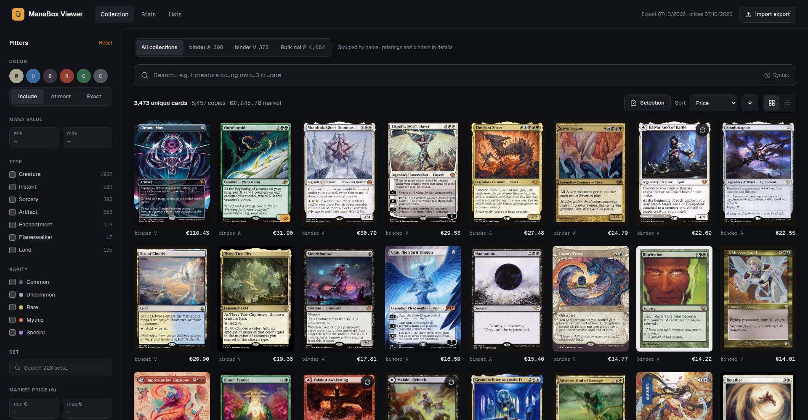
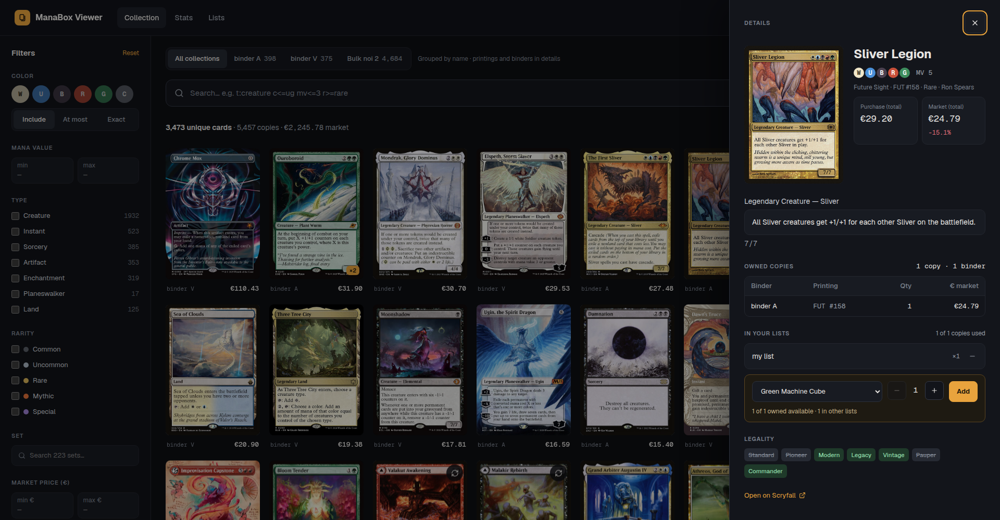
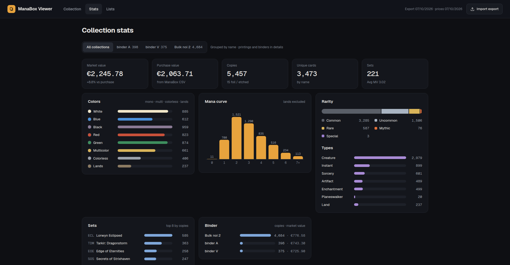
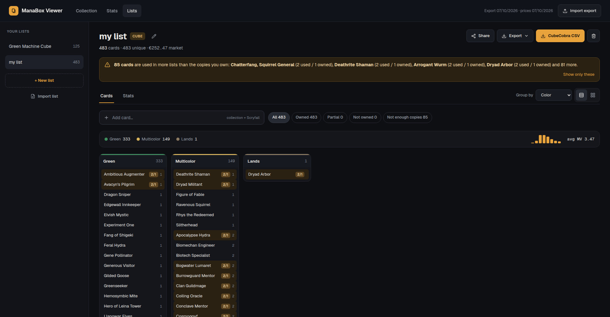
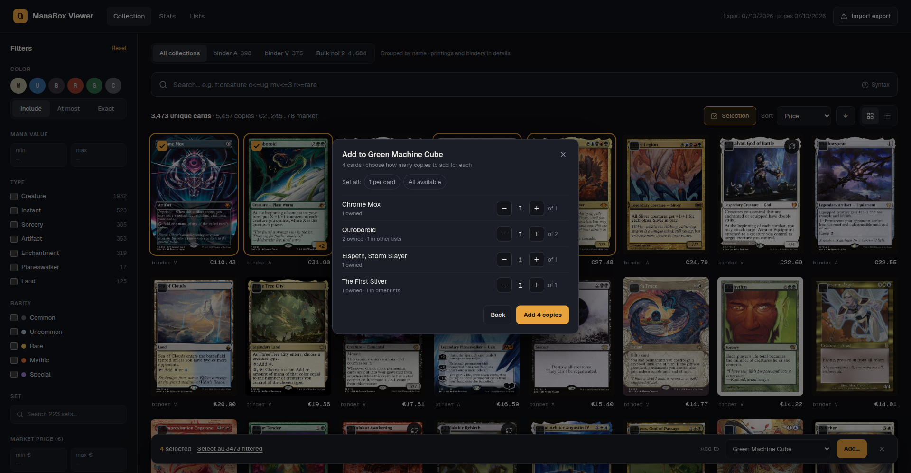
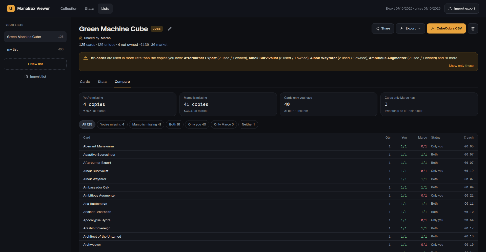

# ManaBox Viewer

A local web app to browse your [ManaBox](https://manabox.app) collection from a computer. You can search it with Scryfall syntax, look at card images and stats, and build cubes and decks: cubes sync with [CubeCobra](https://cubecobra.com), decks with [Moxfield](https://moxfield.com), and both can be shared with friends.



ManaBox's CSV export only has ownership data: name, set, number, binder, quantity and purchase price. ManaBox Viewer fills in the rest from Scryfall (mana cost, types, oracle text, colors, prices, images) and keeps it in a local cache.

If Scryfall is slow or down, requests are retried for about 30 seconds. An import still completes when some cards cannot be fetched: they are fetched again at the next start, or with *Retry missing cards* on the Import page. An import interrupted by a restart resumes on its own.

## Quick start

You only need Docker.

```bash
docker compose up -d --build   # http://localhost:8080
docker compose down            # stop
```

- **Different port:** `PORT=9000 docker compose up -d`.
- **Where data lives:** everything is in `./data`, which survives restarts and rebuilds. That includes the SQLite database, the Scryfall card cache and the downloaded images.
- **First run:** the app asks for your CSV. In ManaBox, go to *Collection → ⋯ → Export → CSV*.
- **What the import costs:** card data is fetched in batches of 75. About 3,500 cards take around 50 requests, spaced 200 ms apart. Images are downloaded and cached the first time they are shown.

## Features

### Collection
- **Two views:** *All collections* groups every printing and binder by card name, while a single binder shows one tile per row of the export.
- **Layout:** a grid or a table, both virtualised so thousands of cards stay smooth.
- **Card preview:** hovering shows a large version of the card (both faces for double-faced cards), and the flip button turns the tile over.
- **Card detail:** oracle text, purchase vs market price, the copies you own per binder and printing, and the lists the card is in.



### Search
Search uses Scryfall syntax, combined with a filter panel for color, mana value, type, rarity, set, binder, price and finish. Everything lives in the URL, so searches can be bookmarked. Examples:

| Query | Meaning |
|---|---|
| `c<=ub t:instant mv<=2` | cheap blue/black instants |
| `o:"draw a card" -t:creature` | non-creature card draw |
| `r>=rare f:pauper` | pauper-legal rares and up |
| `id:azorius is:commander` | Azorius commanders |
| `eur>=5 binder:"binder A"` | valuable cards in one binder |
| `(t:goblin OR t:elf) pow>=2` | grouping with `OR` and parentheses |

The **Syntax** button in the search bar lists every supported key: `c`, `id`, `t`, `o`, `mv`, `m`, `pow`, `tou`, `loy`, `r`, `s`, `cn`, `a`, `kw`, `is:`, `f`, `eur`, `buy`, `qty`, `binder`, `lang` and `year`.

### Stats
Stats cover market and purchase value, colors, mana curve, rarity, types, sets, binders and your most valuable cards. You can see them for the whole collection, a single binder or any list.



### Cubes and decks
Cubes and decks live in two separate sections, *Cubes* and *Decks*; everything in this section works for both, and decks add what is described under [Decks](#decks).

- **Adding cards:** add them one at a time, or select several (click, shift-click for a range, or *Select all N filtered*). For each card you choose how many copies, e.g. "I own 3, put 2 in the cube".
- **Cards by name, not printing:** lists track cards by name, so they stay linked to your collection across new imports.
- **Cards you don't own:** you can add them from a Scryfall search. They are shown dimmed and flagged *Not owned*, or *1/2* when you own fewer copies than the list needs.
- **Overuse warning:** you are warned when a card is used in more cubes and decks than the copies you own (a deck's maybeboard doesn't count).
- **List views:** cube-style columns by color, type, mana value, rarity or tag; an image view; and per-list stats. Each group header shows how many copies you own and what the missing ones cost.
- **Second-level grouping:** *Then by* splits every column into sub-groups by another criterion (type by default, e.g. rarity to match how your cards are stored), separated by a thin line; inside a sub-group cards are sorted by mana value, then name. Both choices are remembered in the browser, separately for cubes and decks.
- **Tags:** label cards with any tags (CubeCobra's *tags*), filter the list by tag and group by it. Tags travel with the CubeCobra CSV and the *Share* file.
- **Tokens:** the *Tokens* tab lists the tokens, emblems and markers (The Monarch, the Initiative, dungeons, Day/Night…) the cards make, which cards make them and whether you own them. Change how many you need, hide the ones you don't, and export them (all, or only the missing ones).
- **CubeCobra sync** (cubes): import a public cube from its URL (*Import cube*) or link an existing cube to one (*Export → Link to CubeCobra cube…*), then see right away which cards you're missing. **Sync** shows what changed on CubeCobra (cards added, removed, new tags) before applying it; the cube decides the cards, while its tags are added to yours (tags removed on CubeCobra are kept locally; a card holds at most 20 tags). A sync that would find no recognisable cards in the cube is refused, so it can't empty the list.
- **You vs CubeCobra:** a linked cube gets a **Compare** tab that sets your collection against what CubeCobra marks as owned (owned, proxied or borrowed count the same): cards you own but CubeCobra doesn't know yet, cards marked owned on CubeCobra but missing from your collection, and so on.
- **Owned status on export:** the CubeCobra CSV marks the copies in your collection as *Owned* (keeping *Premium Owned*); the other copies keep their CubeCobra status (*Proxied*, *Ordered*, *Borrowed*...) or are *Not Owned*. Re-uploading it brings CubeCobra up to date with your collection.
- **Exports:**
  - **CubeCobra CSV** with tags, for *Replace with CSV file upload*;
  - plain **`.txt`** (`1 Name (SET) 123`);
  - a **missing cards** `.txt` you can use as a shopping list.





### Decks
- **Formats:** Standard, Pioneer, Modern, Legacy, Vintage, Pauper, Premodern and Commander (or none). The deck is checked as you edit it: deck and sideboard size, copies (basic lands and *any number* cards excepted), banned, not legal and restricted cards; for Commander, exactly 100 cards, a valid commander or pair of partners, singleton and color identity. Cards that break a rule are marked.
- **Boards:** Commander, Companion, Main deck, Sideboard and Maybeboard. Move a card with the ⇄ button; add cards straight to a board. The maybeboard is shown but not counted: it's left out of totals, stats, overuse, tokens and shopping lists. The copies you own go to the commander first, then the main deck, then the sideboard.
- **Moxfield:** Moxfield doesn't let other servers read its decks, so the deck comes from your browser:
  - *paste* the export (on Moxfield: *More → Export → Copy for Moxfield*) in *Import deck* or *Sync*; boards missing from the export (e.g. a commander set here) are left as they are;
  - or drag **Sync to ManaBox Viewer** (in the Decks sidebar) to your bookmarks bar and click it on a Moxfield deck page: the deck opens in the app, ready to import, or to sync if it's already linked. If the browser blocks the two tabs from talking, the deck is also copied to the clipboard: paste it in the page that opened.

  Sync shows what changed (cards added, removed, moved to another board, copies, format) before applying it; your printings are kept.
- **Exports:** a deck `.txt` with *Commander / Deck / Sideboard* sections for Moxfield or Arena, and the missing cards with or without set codes (*names only* works with shops that use their own codes, like CardTrader).

### Sharing lists
**Share** exports a list in the ManaBox Viewer format: a plain `.txt` that also records how many copies *you* own of each card.

```
# ManaBox Viewer list v2
# name: Pauper Cube
# kind: cube
# exported: 2026-10-07
2 Lightning Bolt (2X2) 117 | owned 1 | tags: Burn; Aggro
1 Counterspell (MH2) 267 | owned 0
```

Anything after `|` is ignored by other tools, so the file still works wherever `1 Name (SET) 123` lists are accepted.

**Import cube** and **Import deck** accept a share file or any plain `.txt` list, either uploaded or pasted.
- **Before saving**, it shows how the list compares with your collection: owned, partial and missing cards, plus the cost to complete.
- **Shared ownership:** when the file comes from another ManaBox Viewer user, the list gets a **Compare** tab showing who has what: *both*, *only you*, *only them* and *neither*, and the copies and value each of you is missing. It's handy for deciding who brings which cards to a shared cube, or what to trade.



### New exports
Importing a new CSV replaces the previous one. You get a summary of the changes (cards added, removed, and quantity changes), and cubes and decks update their ownership automatically.

## Prices

Market prices come from Scryfall in EUR, using foil prices for foils. Cards without a EUR price use the USD price converted at `USD_TO_EUR`, set in `docker-compose.yml` (default 0.92). Purchase prices come from the ManaBox CSV. To fetch today's prices, use *Refresh prices* on the Import page.

## Development

```bash
# backend (port 8765)
cd backend && python3 -m venv .venv && .venv/bin/pip install -r requirements-dev.txt
DATA_DIR=../data .venv/bin/uvicorn app.main:app --reload --port 8765
.venv/bin/python -m pytest

# frontend (port 5173, proxies /api to 8765)
cd frontend && npm install && npm run dev
npx vitest run
```

**Stack:** FastAPI + SQLite on the backend; React 19 + Vite + TypeScript + Tailwind CSS v4 on the frontend. Filtering, sorting and stats run in the browser, and the backend handles imports, the Scryfall cache, images, cubes and decks. The Docker image is a multi-stage build that serves the built frontend from FastAPI.

Card data and images are provided by [Scryfall](https://scryfall.com). ManaBox Viewer is not affiliated with ManaBox, Scryfall, CubeCobra or Wizards of the Coast.
